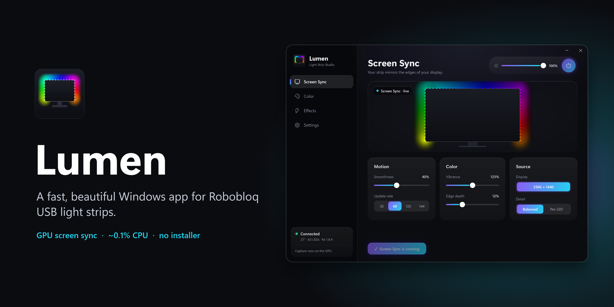
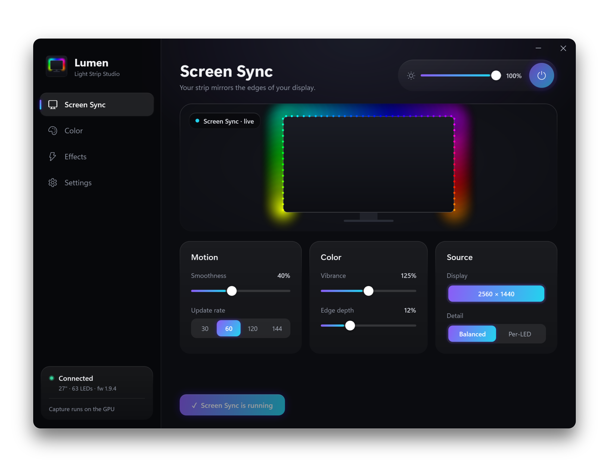
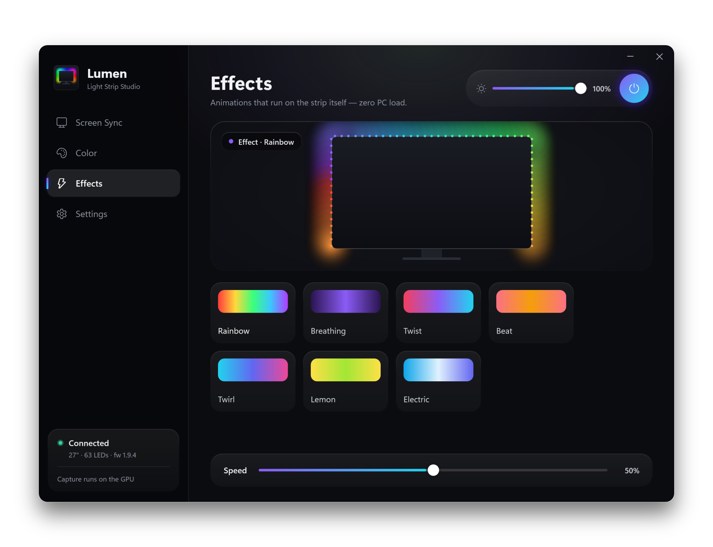
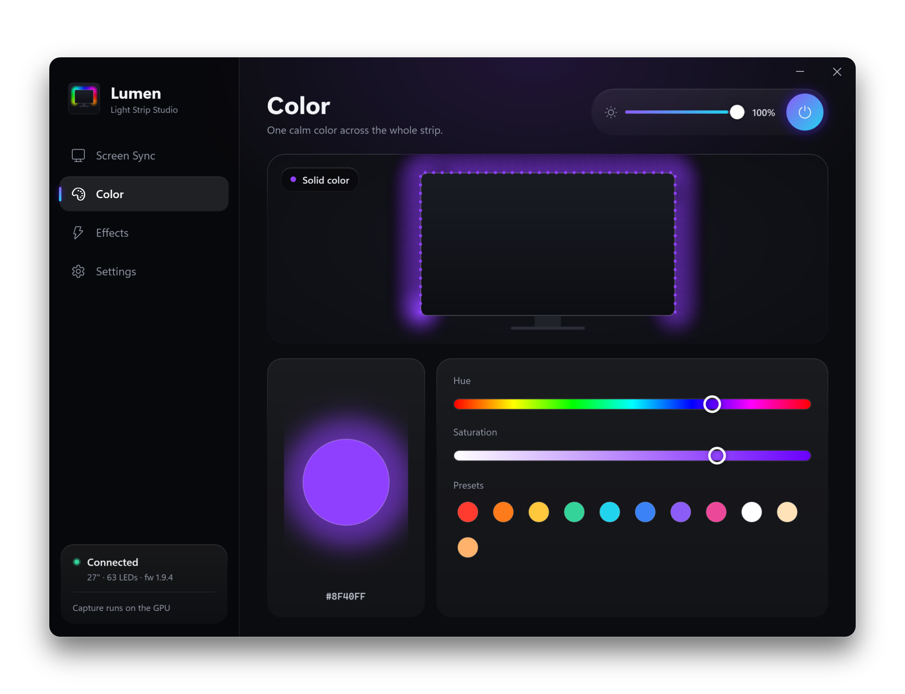
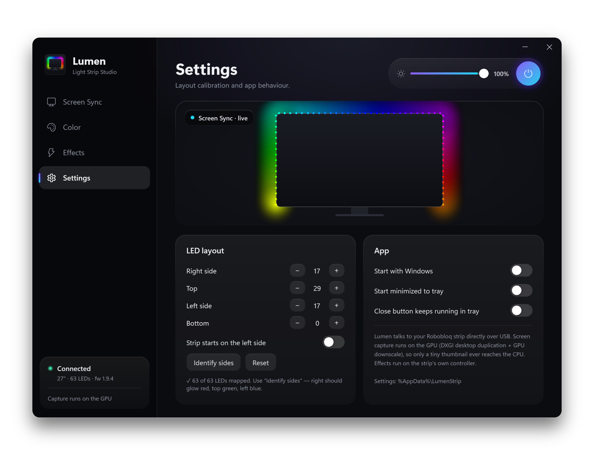

<p align="center">
  
</p>

# Lumen

**A lightweight, good-looking replacement for the official SyncLight app for Robobloq USB monitor light strips.**

The official app is built on Electron (a whole browser running in the background). Lumen is a small native Windows app that talks to the strip directly over USB and does screen capture on the GPU, so screen sync costs about **0.1% CPU**.

<p align="center">
  
  
</p>
<p align="center">
  
  
</p>

## Features

- **Screen Sync**: the strip mirrors the edges of your screen, at 30–144 fps, with adjustable smoothness, vibrance and edge depth. Works with games and HDR.
- **Solid color**: hue and saturation pickers plus presets.
- **Effects**: the strip's 7 built-in animations (Rainbow, Breathing, Twist, Beat, Twirl, Lemon, Electric), which run on the strip itself with zero PC load.
- **Brightness and power** controls that are always on screen, plus a live preview of the glow.
- **LED layout calibration**: per-side LED counts, direction, and an "Identify sides" test.
- **Tray icon**, start with Windows, and close-to-tray.
- **Fluid UI**: interruptible spring animations, instant press feedback and a sliding selection pill. Animations turn off when Windows "Animation effects" is off.

## Why it's light

| | How |
|---|---|
| Capture | DXGI Desktop Duplication. The frame never leaves the GPU: it's copied into a mip-mapped texture, the GPU box-filters it down, and only a ~160×90 thumbnail (~55 KB) is read back. |
| Idle | When nothing on screen changes, it waits for the next frame instead of polling, and sends colors only when they change. |
| Pacing | A high-resolution waitable timer, without changing the system-wide timer resolution. |
| UI | WPF. Preview and stats only update while the window is visible, and memory is trimmed when you hide it to the tray. |
| Dependencies | None. It's built with the C# compiler that ships with Windows (.NET Framework 4.8). |

## Install

1. Download **`Lumen.exe`** from the [latest release](../../releases/latest) and put it anywhere.
2. **Close the official SyncLight app**, so the two don't fight over the strip.
3. Run `Lumen.exe`.
4. Open **Settings → Identify sides**: right should glow red, top green, left blue. If left and right are swapped, turn on **"Strip starts on the left side"**.

Settings are stored in `%AppData%\LumenStrip\settings.ini`.

## Supported hardware

Robobloq USB monitor light strips (USB `VID 1A86`, `PID FE07`, vendor HID interface `0xFF00`). Tested on the 27" / 63-LED kit (firmware 1.9.4). Other sizes report their LED count to the app and should work. If yours doesn't, open an issue with the size and LED count shown in the sidebar.

## Build from source

```bat
build.cmd
```

That's all you need. It uses `%WINDIR%\Microsoft.NET\Framework64\v4.0.30319\csc.exe`, generates the icon, and writes `Lumen.exe`. To regenerate the README images:

```bat
Lumen.exe --shots docs
```

| File | What it does |
|---|---|
| `src/Strip.cs` | USB HID device and Robobloq protocol |
| `src/Capture.cs` | GPU screen capture and downscale |
| `src/Engine.cs` | Screen-sync loop, LED layout, settings |
| `src/Motion.cs` | Spring animation and segmented control |
| `src/App.cs` | Window, tray, UI logic, icon art |
| `src/ui.xaml` | Interface layout and styles |

## Credits and license

The Robobloq protocol and the LED-range merging approach come from [OpenRGB](https://gitlab.com/CalcProgrammer1/OpenRGB)'s `RobobloqLightStripController` (GPL-2.0-or-later), so Lumen is released under the same license. See [LICENSE](LICENSE).

Lumen isn't affiliated with or endorsed by Robobloq.
